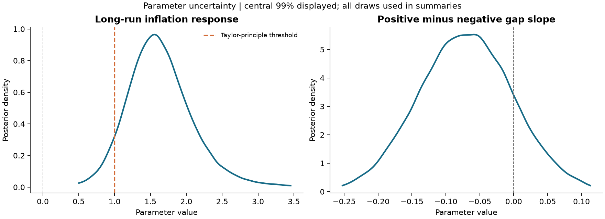
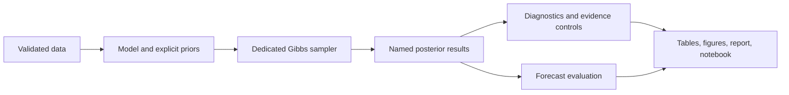

# Project 02: Bayesian Monetary Policy and Recession Risk

**An auditable Python implementation of Bayesian policy-rule estimation, model comparison, and twelve-month recession probabilities.** The project asks whether separate responses to positive and negative output gaps justify extra complexity, and whether financial conditions improve recession probabilities over a simple historical-frequency benchmark.

The contribution combines economic interpretation with reusable software: independent-prior Gaussian Gibbs sampling, Chib marginal likelihoods checked against independent numerical integration, latent-variable probit sampling, and forecast evaluation that separates predictor dates, target dates, and label availability. All estimation logic lives in an importable package; the notebook explains and inspects its outputs.

## Findings and evidence

The policy-rule estimates use **239 quarters, 1955Q1–2014Q3**, matching the actual workbook after constructing the lag. With independent coefficient priors `N(0,10I)` and equal model prior probabilities, the symmetric rule receives approximately **96.4% posterior model probability**. Its long-run inflation response exceeds one with approximately **93.4% posterior probability**. These are conditional model statements, not causal findings.

The evidence calculation agrees with independent quadrature to better than **0.0001 log units** for all four policy specifications. Residual autocorrelation nevertheless challenges the independent-error assumption. Numerical convergence does not establish economic adequacy.

The recession exercise uses the supplied January 1960–February 2026 workbook, the MATLAB simple-return convention, and a twelve-month horizon. Evaluation is explicitly **pseudo-real-time** because historical predictor vintages and verified label-announcement calendars are unavailable. The twelve 2008 targets are all recession months in this workbook, which limits what their forecast scores can establish. The February 2026-origin forecast targets February 2027; its outcome is absent from the input and excluded from scoring.

For the 2008 targets, the probit Brier loss is **0.756**, versus **0.777** for the matched frequency benchmark; its negative log score is **2.154**, versus **2.134** for the benchmark. The ranking is mixed across these two proper scores, so the exercise does not establish general predictive superiority. The February 2026-origin probability for February 2027 is approximately **8.6%**, with parameter uncertainty documented in the report.

Read the [empirical report](results/report.md), [executed analysis notebook](notebooks/project02_analysis.ipynb), [model definitions and derivations](docs/methods.md), and [reference audit](docs/reference_audit.md). Machine-readable results retain Monte Carlo uncertainty, diagnostics, effective training windows, and input checksums.



## Run locally

Python **3.12** was used for the checked-in results; the package supports Python 3.11 or newer. From this directory:

```bash
python3 -m venv .venv
source .venv/bin/activate
python -m pip install -e '.[dev]'
pytest -q
ruff check src tests
```

For the recorded dependency versions, install `requirements-repro.txt` before the editable package. That snapshot records the tested environment; it is not a promise of bitwise equality across operating systems or numerical libraries.

Original teaching workbooks and MATLAB sources remain external. Supply their paths explicitly; no absolute personal paths or data credentials are embedded in the package. The input schema is documented in [methods](docs/methods.md). No data download, reconstruction, or imputation is performed silently.

```bash
bayes-policy policy \
  --data /path/to/InterestRateRule/int_rate_rule_data.xlsx \
  --output results --draws 10000 --warmup 3000 --chains 4 --seed 20261114

bayes-policy recession \
  --data /path/to/RecessionForecast/Recession_Forecast_Data.xlsx \
  --output results/recession --draws 10000 --warmup 3000 --chains 4 --seed 20261114

bayes-policy recession \
  --data /path/to/RecessionForecast/Recession_Forecast_Data.xlsx \
  --output results/recession_delay18 --label-delay-months 18 \
  --draws 10000 --warmup 3000 --chains 4 --seed 20261114

python -c "from bayes_policy.reporting import build_report; build_report('results')"
```

The recession command evaluates January–December 2007 origins by default and includes the February 2026 endpoint when present. `--start` and `--end` select another monthly origin window. An optional `--label-calendar /path/to/calendar.csv` accepts `target_date,label_available_date`; even with such a calendar, real-time claims require predictor vintages and release times. The default zero-delay assumption uses retrospective labels. The 18-month delay is a sensitivity assumption, not a verified historical release schedule.

Each run keeps four chains with 10,000 retained draws **per chain**, after 3,000 warmup draws. Policy specifications use common random streams to make prior sensitivity comparisons less noisy; each recession origin receives its own recorded seed. The CLI returns a nonzero exit code when diagnostic or evidence-control gates fail. Outputs remain available for investigation and must be treated as provisional in that case.

The notebook reads the generated tables and figures without requiring private inputs. Its optional estimation cell reruns the pipeline only when `RUN_ESTIMATION=1`, `POLICY_DATA`, and `RECESSION_DATA` are set. It contains no second implementation of either sampler.

## Object-oriented design

The design uses composition and explicit data contracts. It avoids a large inheritance hierarchy: both policy specifications are instances of the same Gaussian model with different labeled design matrices, while probit has a genuinely different latent-variable sampler.

| Component | Responsibility |
| --- | --- |
| `InterestRateData`, `RecessionData`, `RegressionData` | Validate calendars and numeric inputs; construct labeled matrices and origin/target pairs. |
| `NormalPrior`, `GammaPrecisionPrior` | Validate immutable prior parameters and make Gamma rate/scale conventions explicit. |
| `GaussianRegression`, `BayesianProbit` | Define likelihoods and conditional distributions. |
| `GaussianGibbsSampler`, `ProbitGibbsSampler`, `SamplerConfig` | Own sampling transitions, independent random streams, warmup, and retained draws. |
| `PosteriorResult` | Preserve chain dimensions and metadata; summarize, diagnose, save, and load draws. |
| `ChibModelComparison` | Bind results to exact model inputs, calculate evidence, and enforce common samples. |
| `ExpandingWindowEvaluator` | Enforce target maturity and label availability; refit and score matched benchmarks. |
| Pipeline and reporting functions | Orchestrate analyses and render artifacts without duplicating estimation logic. |



## Validation and limits

The test suite checks exact finite model probabilities, analytic Gaussian conditionals, covariance-factor orientation, evidence against independent integration, simulated parameter recovery, a probit posterior against numerical quadrature, rare-event latent truncation, calendar integrity, and future-label exclusion. Continuous integration runs these controls with generated inputs and does not pretend to rerun private workbooks.

ArviZ supplies rank-normalized split R-hat, bulk/tail ESS, and MCSE. The computational gate requires `R-hat <= 1.01` and both ESS measures `>= 400` for all model parameters and policy-derived quantities. These checks complement trace plots and independent mathematical controls; they do not prove model correctness.

Important limitations remain visible in the report: residual dependence, full-sample regime changes, unverified workbook vintages and trend-inflation construction, retrospective recession labels, and a short evaluation window containing only one outcome class. No trading, causal-policy, or broad forecast-superiority claim follows from these exercises.

## Repository contents

```text
project2/
├── pyproject.toml
├── requirements-repro.txt
├── src/bayes_policy/       # models, data, samplers, comparison, evaluation, reporting, CLI
├── tests/                 # mathematical, simulation, and timing controls
├── docs/                  # methods and reference discrepancies
├── notebooks/             # executed results-oriented analysis
└── results/               # numeric evidence, diagnostics, manifests, figures, report
```

Original workbooks and reference programs are excluded because their redistribution rights are unverified. Private posterior draw archives live under ignored `draws/` directories and can be regenerated from the inputs. The committed artifacts allow inspection without access to those materials.

The [portfolio overview](../README.md) connects this implementation to later lag-uncertainty and forecasting projects. The Gaussian regression, posterior-result, and model-comparison components are designed for reuse; later project implementations remain separate work.
