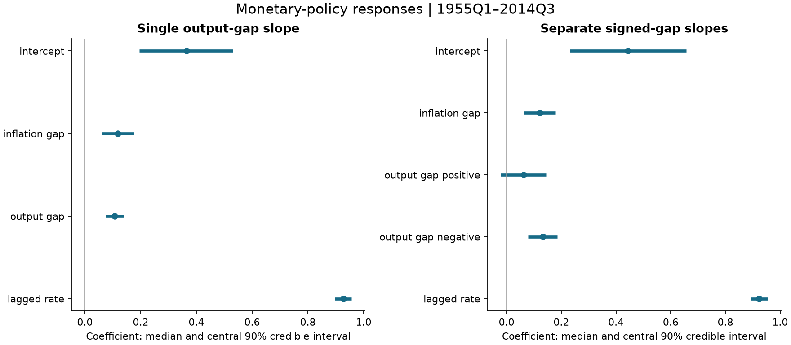
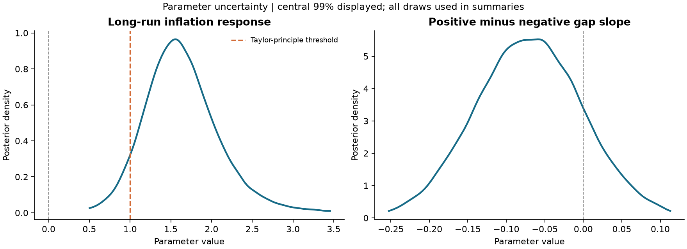
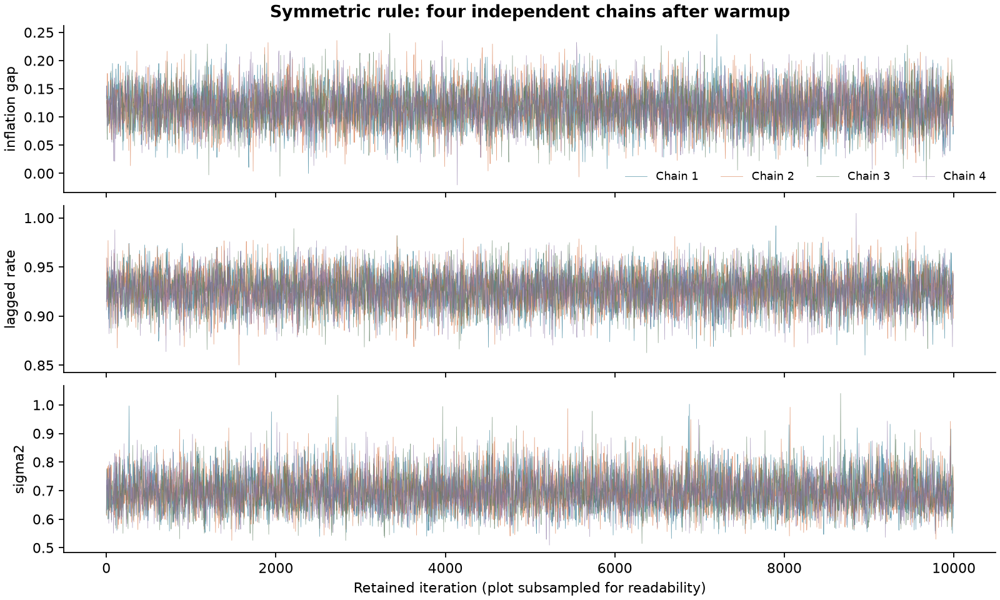
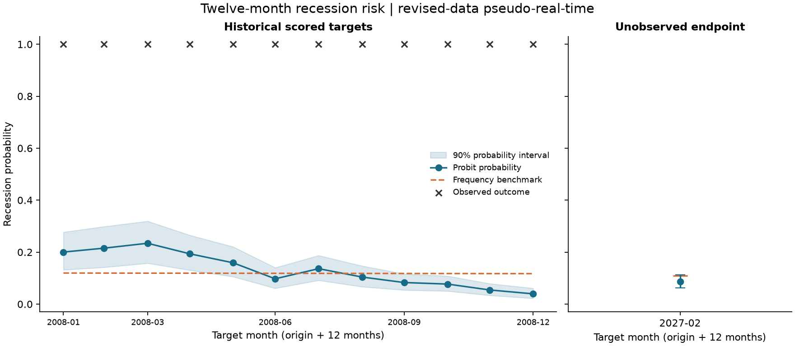
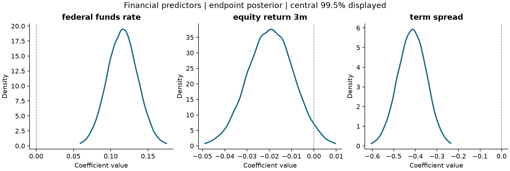
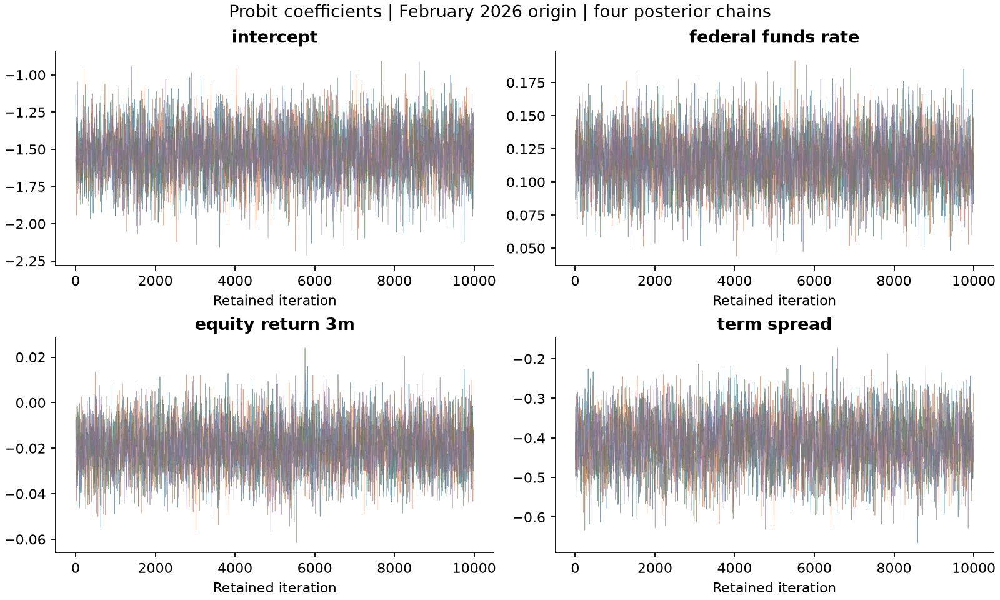

# Empirical results and validation

Generated from the checked-in numeric artifacts. Source workbooks are external; their hashes and sample definitions are recorded in the manifests. Computational diagnostics assess simulation reliability, not economic identification.

## Monetary-policy associations

The effective sample is 239 quarterly observations, 1955Q1–2014Q3. Primary coefficients have independent N(0,10I) priors and precision has Gamma(shape=1.5, rate=1.5).

| Model / parameter | OLS | Posterior median | SD | Central 90% interval | R-hat | Bulk ESS |
| --- | ---: | ---: | ---: | --- | ---: | ---: |
| symmetric_v10 / intercept | 0.3642 | 0.3645 | 0.1019 | [0.1960, 0.5303] | 1.00005 | 39,792 |
| symmetric_v10 / inflation_gap | 0.1174 | 0.1175 | 0.0352 | [0.0599, 0.1754] | 0.99999 | 39,898 |
| symmetric_v10 / output_gap | 0.1074 | 0.1074 | 0.0206 | [0.0737, 0.1412] | 0.99992 | 39,806 |
| symmetric_v10 / lagged_rate | 0.9265 | 0.9266 | 0.0186 | [0.8958, 0.9570] | 1.00002 | 40,119 |
| symmetric_v10 / sigma2 | — | 0.6921 | 0.0647 | [0.5984, 0.8097] | 0.99997 | 38,756 |
| asymmetric_v10 / intercept | 0.4438 | 0.4432 | 0.1294 | [0.2315, 0.6566] | 0.99999 | 40,263 |
| asymmetric_v10 / inflation_gap | 0.1213 | 0.1217 | 0.0355 | [0.0629, 0.1796] | 1.00002 | 40,235 |
| asymmetric_v10 / output_gap_positive | 0.0617 | 0.0616 | 0.0503 | [-0.0208, 0.1446] | 1.00002 | 39,570 |
| asymmetric_v10 / output_gap_negative | 0.1325 | 0.1327 | 0.0325 | [0.0794, 0.1860] | 0.99997 | 40,166 |
| asymmetric_v10 / lagged_rate | 0.9236 | 0.9235 | 0.0188 | [0.8926, 0.9543] | 1.00005 | 40,623 |
| asymmetric_v10 / sigma2 | — | 0.6926 | 0.0646 | [0.5978, 0.8086] | 1.00013 | 37,785 |

## Model comparison and sensitivity

Posterior model probabilities below use equal prior model probabilities. Each pair explains identical observations; a preference is relative to these two specifications.

| Model | Chib log evidence | MCSE | Quadrature log evidence | Difference | Posterior model probability |
| --- | ---: | ---: | ---: | ---: | ---: |
| symmetric_v10 | -313.627359 | 0.000092 | -313.627419 | 0.000060 | 96.4437% |
| asymmetric_v10 | -316.927583 | 0.000108 | -316.927657 | 0.000073 | 3.5563% |
| symmetric_v5 | -312.292483 | 0.000092 | -312.292543 | 0.000060 | 95.0621% |
| asymmetric_v5 | -315.250068 | 0.000108 | -315.250141 | 0.000074 | 4.9379% |

With the asymmetric model's prior probability set to 25% or 75%, its posterior probability is 1.21% or 9.96%, respectively. This dependence on prior assumptions is part of the result.

## Long-run response and asymmetry

For the symmetric 10I model, the long-run inflation-response median is 1.599, with central 90% interval [0.947, 2.482]. P(theta>0) is 99.9425%; P(theta>1) is 93.4300% (MCSE 0.0012). These are distinct economic thresholds.

Unstable lag-coefficient draws account for 0.0125%; 0.0325% have abs(1-rho)<0.01. The explicitly stability-conditioned P(theta>1) is 93.4417%. Unconditional quantities retain all draws.

In the asymmetric 10I model, P(positive-gap slope minus negative-gap slope > 0) is 15.83%. A lower slope during positive gaps is more probable within that model, but the marginal-likelihood comparison favors the simpler common-slope specification.

## Numerical reliability and model limitations

Sampler and derived-quantity diagnostic gates passed: **True**. Independent evidence controls passed: **True**. Thresholds are R-hat <=1.01 and bulk/tail ESS >=400. All retained draws enter summaries; only trace displays are subsampled.

The symmetric model's residual lag-one autocorrelation is 0.176. The conditional predictive check assigns probability 0.0075 to simulated absolute autocorrelation at least as large as observed. This is evidence of an inadequate independent-error assumption, not a classical p-value. Historical regime changes, time-varying volatility and the lower bound are additional concerns. These estimates do not identify a causal policy rule.

## Recession probabilities

Revised-data **pseudo-real-time** evaluation. Primary training assumes retrospective labels available at their target month end. Historical NBER announcement availability and predictor vintages are not established. Forecasts made in 2007 target the corresponding months in 2008; a separate February 2026 origin targets February 2027.

| Origin | Target | Training n | Last training target | Probability | 90% probability interval | Actual |
| --- | --- | ---: | --- | ---: | --- | ---: |
| 2007-01-31 | 2008-01-31 | 550 | 2007-01-31 | 20.03% | [13.20%, 27.71%] | 1 |
| 2007-02-28 | 2008-02-29 | 551 | 2007-02-28 | 21.54% | [14.16%, 29.86%] | 1 |
| 2007-03-31 | 2008-03-31 | 552 | 2007-03-31 | 23.42% | [15.74%, 31.92%] | 1 |
| 2007-04-30 | 2008-04-30 | 553 | 2007-04-30 | 19.37% | [13.08%, 26.54%] | 1 |
| 2007-05-31 | 2008-05-31 | 554 | 2007-05-31 | 15.90% | [10.56%, 22.07%] | 1 |
| 2007-06-30 | 2008-06-30 | 555 | 2007-06-30 | 9.74% | [6.10%, 14.03%] | 1 |
| 2007-07-31 | 2008-07-31 | 556 | 2007-07-31 | 13.64% | [9.16%, 18.72%] | 1 |
| 2007-08-31 | 2008-08-31 | 557 | 2007-08-31 | 10.41% | [6.69%, 14.72%] | 1 |
| 2007-09-30 | 2008-09-30 | 558 | 2007-09-30 | 8.30% | [5.42%, 11.63%] | 1 |
| 2007-10-31 | 2008-10-31 | 559 | 2007-10-31 | 7.71% | [5.03%, 10.82%] | 1 |
| 2007-11-30 | 2008-11-30 | 560 | 2007-11-30 | 5.45% | [3.37%, 7.91%] | 1 |
| 2007-12-31 | 2008-12-31 | 561 | 2007-12-31 | 3.95% | [2.23%, 6.10%] | 1 |
| 2026-02-28 | 2027-02-28 | 779 | 2026-02-28 | 8.64% | [6.33%, 11.25%] | unobserved |

Intervals describe uncertainty about the latent recession probability, not intervals for a binary outcome. February 2027 is absent from the source workbook and excluded from scores. The February 2026-origin forecast is a historical exercise, not a live forecast as of this report.

| Model | Observed targets | Mean Brier loss | Mean negative log score |
| --- | ---: | ---: | ---: |
| probit | 12 | 0.755929 | 2.154125 |
| benchmark | 12 | 0.777236 | 2.133789 |

The benchmark uses exactly the same training labels with Beta(1,1) smoothing. Smaller losses are better. All twelve 2008 outcomes are recessions in the input indicator: these scores cannot establish broad calibration or discrimination. No significance claim is made from this short, overlapping-horizon exercise.

All forecast coefficient diagnostic gates passed: **True**.

### Financial-predictor coefficients

The February 2026-origin fit uses 779 matched observations with targets through February 2026. These latent-index coefficients describe predictive associations, not percentage-point changes in recession probability or causal effects.

| Parameter | Posterior median | SD | Central 90% interval | R-hat | Bulk ESS |
| --- | ---: | ---: | --- | ---: | ---: |
| intercept | -1.5256 | 0.1717 | [-1.8106, -1.2467] | 1.00057 | 5,770 |
| federal_funds_rate | 0.1158 | 0.0205 | [0.0822, 0.1499] | 1.00056 | 5,969 |
| equity_return_3m | -0.0194 | 0.0104 | [-0.0365, -0.0022] | 1.00048 | 5,337 |
| term_spread | -0.4147 | 0.0664 | [-0.5257, -0.3074] | 1.00146 | 3,374 |

### Label-delay sensitivity

A separate run assumes an 18-month label delay. This is an illustrative availability assumption, not an empirically verified NBER publication calendar. Its probit Brier loss is 0.742431, versus 0.770287 for its matched benchmark. All diagnostic gates passed: **True**. See the separate CSV for every effective training window.

## Reproduction and scope

See [the project README](../README.md) for commands and [methods](../docs/methods.md) for assumptions and derivations. The [reference audit](../docs/reference_audit.md) records discrepancies with earlier work. The committed tables and figures are reproduced results; original workbooks and private posterior draw archives are excluded. CI checks scientific controls using generated data and does not claim to rerun inaccessible empirical workbooks.
