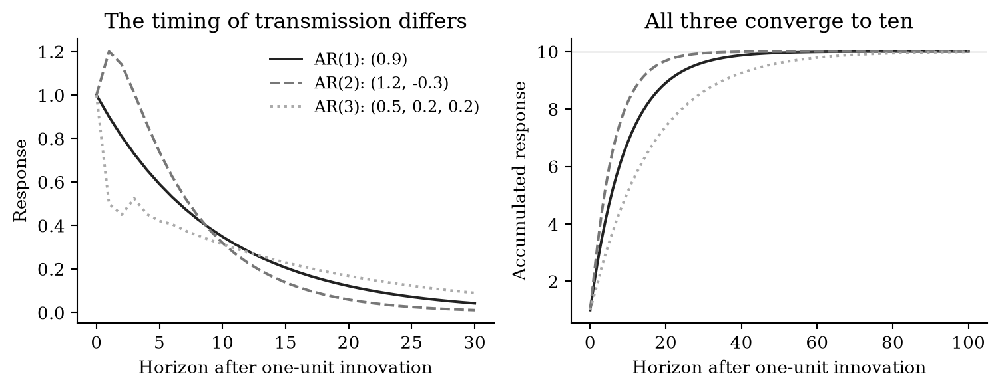
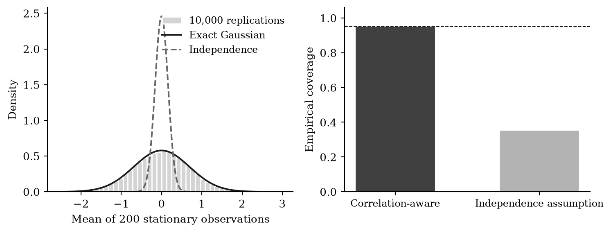

# Project 03: Persistence and Shock Propagation in Time Series

How much of a shock remains after twenty periods, and how much information does a persistent series contain? This project answers those questions with controlled autoregressive and moving-average experiments. Parameters are fixed inputs; observations are synthetic. It separates model stability, shock transmission, and the precision of time averages.

**Implemented and executed:** an installable Python package, command-line experiment pipeline, scientific tests, executed notebook, numerical controls, figures, and an English research report. The [executive summary](EXECUTIVE_SUMMARY.md) and [research report (PDF)](docs/persistence_shock_propagation.pdf) present the economic interpretation. The [methods](docs/methods.md) give equations, conventions, and primary references.

## Results

- The stable AR(1), AR(2), and AR(3) share an infinite accumulated unit-shock response of **10**, but their totals through horizon 20 are **8.906**, **9.677**, and **7.394**. Their stationary variances also differ: **5.263**, **7.429**, and **3.492**.
- The AR(2) coefficients **(1.2, -0.3)** produce a response of **1.20** at horizon one, then decay. Its spectral radius is **0.844949**. A first-lag coefficient above one can coexist with a stable multiple-lag process.
- For a stationary AR(1) with coefficient **0.9**, 200 observations have the mean-estimation precision of **11.05 independent observations**. Ignoring their serial covariance understates the exact mean variance by a factor of **18.10**.
- Across **10,000** independent stationary replications, a nominal 95% interval assuming independence attains **35.27%** coverage; using known serial covariance gives **95.00%**. Parameters are known in this experiment. These are repeated-sample coverage results, not Bayesian intervals.
- Changing the AR(1) intercept from zero to 0.5 shifts the stationary mean by **five**, leaving centered dynamics unchanged. The paired paths use identical innovations.
- The stable and unstable AR(3) spectral radii are **0.939481** and **1.054380**. A unit-circle AR(2) is treated separately. The finite MA(2) control is covariance stationary but its specified innovation representation is noninvertible.





All units and horizons are generic model units and periods. No empirical coefficients, observed causal effects, or live forecasts are claimed. Finite sample path statistics are not used to prove stationarity. Read the [computed results](results/report.md) for precise values and verification errors.

## Run the project

Python 3.12 was used for the recorded artifacts; the package supports Python 3.11 or newer. From this directory:

```bash
python3 -m venv .venv
source .venv/bin/activate
python -m pip install -e '.[dev,report]'
pytest -q
ruff check src tests scripts
shock-dynamics --output results --seed 20261115 --replications 10000
python scripts/build_research_report.py --date 2026-11-15
```

No external dataset, credential, or data download is required. The version snapshot in `requirements-repro.txt` identifies the environment used for the recorded numerical work; cross-platform bitwise equality is not promised. The report dependency is optional for running the numerical pipeline.

The pipeline records six AR specifications, one finite MA control, and an independent stationary mean-precision experiment. It writes CSV paths and responses, JSON settings and numerical controls, figures, and a computed Markdown report. A failed deterministic control raises an error after preserving artifacts for diagnosis.

## Read and reproduce the notebook

Open [the executed notebook](notebooks/project03_analysis.ipynb) in Jupyter. Its default mode reads committed artifacts and calls the importable dynamics API for inspection. It does not contain a second simulator. Set `RUN_SIMULATIONS=1` only to request a full numerical rerun. The notebook validation record contains its checksum, executed-cell count, and error count.

Build an unexecuted copy with `python scripts/build_notebook.py`. Re-execute before replacing a published executed notebook or its validation record. The separate PDF builder reads the generated CSV and JSON results; it does not estimate or simulate new numbers.

## Design and interpretation

The initial state is always explicit and ordered **most recent lag first**. AR(1) paired paths start at their respective stationary means, share 700 innovations and discard 500 periods. AR(3) comparisons start from identical zero states, share 200 innovations and have no burn-in. Stable initialization at the mean is not claimed to be exact stationary initialization. Only the mean-precision experiment starts from exact stationary Gaussian draws.

Matrix, recursive, and controlled-shock responses cover horizons 0 through 100, including the contemporaneous response of one. An independent SciPy filter provides another implementation. Infinite cumulative sums and stationary moments are available only for models classified as strictly stable. The root boundary tolerance is 1e-10; nearly unit-root cases are flagged rather than assigned unreliable stationary moments.

| Component | Responsibility |
| --- | --- |
| `ARSpecification`, `MASpecification` | Validate immutable model parameters without simulation settings. |
| `SimulationConfig` | Validate length, burn-in, and seed. |
| `ARSimulator`, `MASimulator` | Generate explicit innovations and paths from documented initial histories. |
| `DynamicsAnalyzer` | Analyze companion eigenvalues, roots, stable moments, responses, and exact mean variance. |
| `MAAnalyzer` | Calculate finite autocovariances and classify invertibility of the given representation. |
| `SimulationResult`, `ImpulseResponseResult` | Preserve states, innovations, configurations, response methods, and cumulative sums. |
| Pipeline and reporting functions | Coordinate experiments and render artifacts without duplicating model logic. |

The design uses composition rather than a large inheritance hierarchy. The numerical analyzers work without generating random paths, and plotting consumes computed results.

## Scientific verification

The test suite checks reciprocal root/eigenvalue relationships, zero trailing coefficients, boundary cases, analytic AR(1) moments, Lyapunov residuals, variance from response sums, an independent Toeplitz covariance calculation, shock normalization and initial-state ordering, three response methods against SciPy filtering, variance-to-standard-deviation conversion, finite MA covariance and invertibility, malformed inputs, and seeded reproduction.

Run `python scripts/verify_artifacts.py` to verify the recorded source, numerical, notebook, and PDF identities.

The pipeline additionally records all numerical discrepancies in `results/numerical_validation.json`. Source and output SHA-256 hashes are in `results/manifest.json`. CI runs generated scientific controls and does not depend on private data. The known-parameter setting permits exact checks; an empirical extension would need a dataset, identification assumptions, and an inference stage.

## Repository contents

```text
project3/
├── pyproject.toml
├── requirements-repro.txt
├── EXECUTIVE_SUMMARY.md
├── src/shock_dynamics/
├── tests/
├── scripts/                 # notebook and PDF builders
├── docs/                    # derivations and research PDF
├── notebooks/               # executed analysis
└── results/                 # paths, responses, precision experiment, controls, figures
```

This project complements [monetary policy and recession risk](../project2/README.md) by studying mechanisms behind lagged dynamics. [Project 04](../project4/README.md) extends the research design to uncertainty about lag order; its implementation remains pending.
