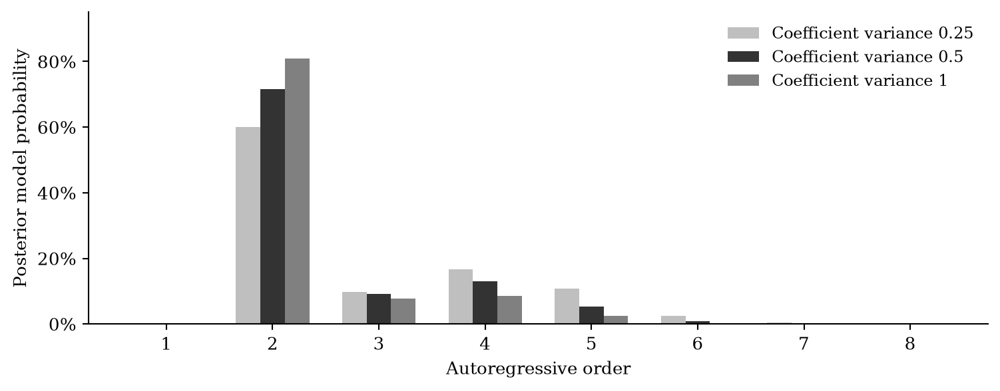
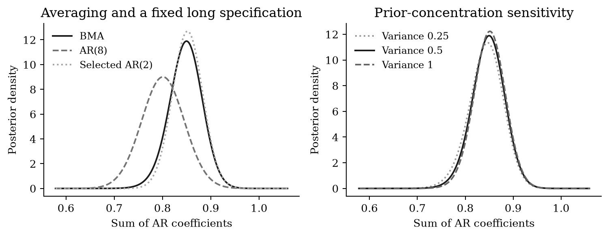

# Project 04: Lag Uncertainty and Bayesian Model Averaging

In my fourth doctoral assignment, I compared and averaged eight possible lag orders. The model using the previous two observations received **71.54%** posterior probability. The portfolio confirms that weight to two decimal places. For the eight-lag model, the mean sum of coefficients was **0.8006** in class and **0.8008** in the portfolio's integration check. The new question is how much these conclusions depend on prior beliefs: the two-lag model's weight ranges from **60.01% to 80.96%**, while model-averaged persistence stays between **0.8430 and 0.8504**. [Saved coursework estimates](../coursework_results.csv)

How much of a persistence conclusion comes from choosing the lag order? This study compares AR(1)-AR(8) on a common sample and carries model uncertainty into a shared coefficient-sum distribution and finite-horizon shock responses. It combines Gibbs sampling, Chib marginal likelihoods, independent integration, and model averaging.

**Implemented and executed.** The project includes an installable Python package, 24 model/prior fits, scientific tests, evidence and posterior controls, an executed notebook, a research report, and reproducibility records. Read the [executive summary](EXECUTIVE_SUMMARY.md), [English research report (PDF)](docs/lag_uncertainty_model_averaging.pdf), or [methods](docs/methods.md).

## Findings

- Under the primary prior, **AR(2) receives 71.54% posterior model probability**, while other orders retain 28.46%. Across coefficient-prior variances 0.25, 0.5 and 1, the AR(2) probability ranges from **60.01% to 80.96%**. These are preferences within the declared model set, not identification of the unknown generating process.
- The model-averaged coefficient-sum mean is **0.8478**, with a central 90% interval **[0.7901, 0.9029]**. Fixed AR(8) gives **0.8008**, with interval **[0.7276, 0.8739]**. These scalar reference summaries integrate coefficients and precision, using Chib model weights; Gibbs mixtures supply a separate numerical comparison.
- Between-model uncertainty contributes **10.38%** of the primary coefficient-sum variance. The mixture is wider than the selected AR(2) distribution but narrower than fixed AR(8). Accounting for model uncertainty need not widen an interval relative to every possible fixed model.
- The horizon-ten response median is **0.072** under model averaging and **-0.129** under AR(8). Both central 90% intervals include zero. Finite response intervals are pointwise, and all posterior draws are retained.
- Scalar integration assigns approximately **3.44e-6** probability to a coefficient sum above one. Finite Gibbs event counts can be zero even when this probability is positive. The coefficient sum is not a sufficient root-stability diagnostic.





## Data and model contract

The supplied `sim_arma_data.csv` is one **headerless** numeric column with 200 observations. Reading its first row as a header would remove an observation. All candidates condition on the initial eight observations and explain the same **192 targets, observations 9-200**. The original ordering and units are retained; dates and a generating process are not assigned. The file remains external, with its SHA-256 and parsing contract in `results/data_manifest.json`.

The primary independent priors are `c ~ N(0,100)`, each AR coefficient `N(0,0.5)`, and precision `Gamma(shape=1, rate=3)`. All numbers in the normal priors denote variances. Coefficient-prior sensitivities use variances 1 and 0.25. Each setting assigns model prior probability 1/8 to orders 1-8. Additional proper-intercept and Gamma-parameterization checks are integration-only sensitivities, separately labeled.

## Run and inspect

Python 3.12 was used for the recorded calculation. Install the local shared packages together; their names alone are not substitutes for the checked-in sources. From `project4`:

```bash
python3 -m venv .venv
source .venv/bin/activate
python -m pip install -e ../project2 -e ../project3 -e '.[dev,report]'
pytest -q
ruff check src tests scripts
lag-uncertainty --data /path/to/sim_arma_data.csv --output results \
  --draws 10000 --warmup 3000 --chains 4 --seed 20261117
python scripts/build_research_report.py --date 2026-11-17
python scripts/verify_artifacts.py
```

The numerical pipeline does not download, reconstruct, or silently replace the input. The public notebook and tables can be inspected without that file. A full rerun requires the matching source data. Use a fresh output directory for an independent RNG replay or a changed sampler configuration. Cached private draws are reused only after data, prior, configuration, and sampling-source checks.

Each of the 24 main fits keeps four chains with 10,000 retained draws per chain after 3,000 warmup iterations. Private archives and scalar mixture resamples are ignored by Git. Exact reproduction claims refer to the recorded environment; source fingerprints and numerical controls support checks across environments. The direct external-dependency snapshot is in `requirements-repro.txt`.

Open the [executed notebook](notebooks/project04_analysis.ipynb) in Jupyter or VS Code with the project environment. It reads the generated artifacts and demonstrates the importable mixture API. Set `RUN_ESTIMATION=1` and `AR_DATA` only for an intentional full rerun. `scripts/build_notebook.py` rebuilds an unexecuted copy; re-execute before publishing a new notebook validation record.

## What is averaged

The shared scalar is the sum of AR coefficients, excluding the intercept. The posterior mixes model-specific scalar distributions with their model probabilities. It does not average unequal-length parameter vectors into a new fitted AR model. The same principle is applied to each finite-horizon impulse response.

Public scalar tables distinguish weighted empirical Gibbs summaries from `integration_*` reference summaries. Rare probabilities use direct integrated survival functions. The 100,000 resamples per prior setting draw from the stored finite Gibbs pools; they add no information about unseen tail events. Between-model posterior variation is distinct from Monte Carlo error in estimating the mixture.

The root calculation uses every coefficient vector. Stable-draw frequencies are simulation summaries, not exact probabilities of one. Separate model weights conditional on stability are recorded using the appropriate event-probability adjustment. They do not replace the primary unrestricted analysis.

## Object-oriented design and reuse

| Component | Responsibility |
| --- | --- |
| `IndexedARData`, `ARDesignBuilder` | Preserve ordinal positions, immutable arrays, lag alignment and common conditioning. |
| `PriorSpecification` | Create proper independent priors and normalized regression models. |
| Shared Project 02 components | Supply Gaussian likelihoods, Gibbs transitions, chain-preserving results, and Chib evidence. |
| `LagOrderStudy` | Coordinate model/prior cases, validated archives, diagnostics, and reproducible outputs. |
| `IntegratedGaussianReference` | Use SVD and one-dimensional quadrature for independent evidence and scalar posterior controls. |
| `ChibOrdinateAudit` | Check evaluation-point sensitivity and preserve conditional-density batches. |
| `ModelAveragedInference` | Evaluate scalar mixtures, draw model-index resamples, decompose variance, and condition weights on events. |
| `PosteriorDynamics` | Transform all draws into sums, eigenvalue radii, and finite responses, with Project 03 cross-checks. |
| Reporting and artifact scripts | Render computed results and verify source, numerical, notebook and PDF identities. |

The shared sampler's label adapter supports ordinal observations while preserving the original date formatting for Project 02. Its statistical transitions are unchanged. The numerical package does not require a second copy of the Gaussian model or a simulator hidden inside plotting code.

## Scientific controls and interpretation

Validation checks common targets, lag alignment, prior variances and Gamma rates, closed-form evidence controls, reversal of integration order, independent SVD and conditional-matrix integrals, Chib evaluation at three points, scalar posterior means, rare-tail survival functions, exact mixture moments, one-model limits, event-conditioned weights, seeded resampling, and companion-response agreement. Sampling gates cover both model parameters and continuous derived quantities.

The report gives actual errors, effective sample sizes, R-hat values, and joint-batch Monte Carlo errors. Good chain diagnostics do not establish model adequacy or certify rare-event accuracy. All conclusions are conditional on the supplied series and candidate set; no true AR order, calendar frequency, observed causal effect, or forecast superiority is claimed.

## Contents

```text
project4/
├── pyproject.toml
├── requirements-repro.txt
├── EXECUTIVE_SUMMARY.md
├── src/lag_uncertainty/
├── tests/
├── scripts/
├── docs/
├── notebooks/
└── results/                 # tables, diagnostics, figures, configurations and manifests
```

This study extends [Project 02](../project2/README.md)'s Bayesian inference and [Project 03](../project3/README.md)'s dynamic analysis. [Project 05](../project5/README.md) remains a research design for predictive distributions and growth at risk.
