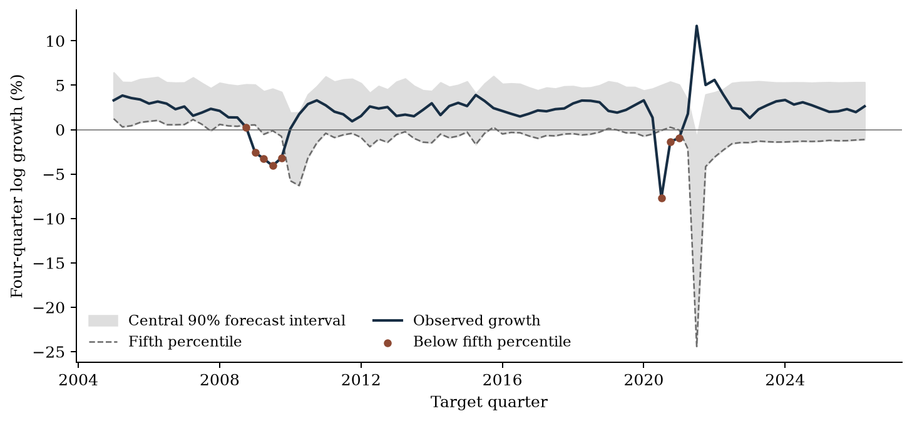

# Probabilistic GDP Forecasts and Growth at Risk

In my fifth doctoral assignment, the trend AR(4) put the fifth percentile of four-quarter U.S. GDP growth at **−0.218 log percentage points** from 2026Q1. The portfolio estimates **−0.342** with the same pandemic smoothing. The original chart also compared a four-quarter AR forecast with a one-quarter forecast using Treasury spreads. The revised study matches horizons and evaluates realized growth. Across **78 matched annual windows**, root mean squared error fell from **2.19** with the coursework method to **2.07** with the portfolio AR. Across the **13 post-pandemic origins**, the coursework method was closer on average, **0.58 versus 0.63**. These windows overlap and use revised GDP. [Saved coursework estimates](../coursework_results.csv) · [Matched forecasts](results/course_comparison.csv)

In a separate test with observed GDP across all 86 annual origins, the benchmark is a random walk with drift. After U.S. GDP fell in 2020Q2, a trend AR(4) projected a further 11.50% decline over the next four quarters. The economy grew 11.68% in log terms. That single forecast accounts for 57% of the model's total squared annual forecast error. Yet the same model beat a random walk with drift on average loss for the fifth percentile. How much a forecaster values each model depends on the outcome they need to predict.

[Research report (PDF)](docs/gdp_growth_at_risk.pdf) · [Executive brief (PDF)](docs/executive_summary.pdf) · [Executive summary](EXECUTIVE_SUMMARY.md) · [Executed notebook](notebooks/project05_analysis.ipynb)

## Separate comparison against a drift benchmark

| Measure | Drift benchmark | Trend AR(4) | ARDL with Treasury spread |
| --- | ---: | ---: | ---: |
| One-quarter RMSE, 89 outcomes | 1.339 | 1.800 | 1.818 |
| One-quarter 5% quantile loss | 0.1921 | 0.1855 | 0.1852 |
| Four-quarter RMSE, 86 outcomes | 2.306 | 3.297 | |
| Four-quarter 5% quantile loss | 0.4573 | 0.4192 | |
| Four-quarter outcomes below the 5th percentile | 10 of 86 | 8 of 86 | |

Horizons measure cumulative changes in 100 times log real GDP. Lower values are better for both loss measures. Four-quarter outcomes from consecutive origins overlap. The drift benchmark had lower RMSE in each of four nonoverlapping origin groups. The trend AR had lower quantile loss in three of those four groups. See the [scores by origin group](results/scores.csv).



## Reference forecast

Using GDP through 2026Q1, the AR forecast for the year to 2027Q1 had mean growth of 2.04%, a 5th percentile of −1.15% and contraction probability of 14.4%. Interpolating eight pandemic observations in training moved that threshold to −0.34%. The historical comparison uses the first GDP release date for each origin and revised levels for estimation and scoring. The [protocol](docs/protocol.md) and [methods](docs/methods.md) document the release calendar, quarterly spread aggregation, priors and uncertainty calculations.

## Run from the project5 directory

Use Python 3.12 and the checked-in versions of the shared packages. The verified snapshots of GDPC1 and T10Y2Y remain external. The [input hashes](results/run.json) identify both files. Inspecting the notebook, grading the recorded forecasts and rebuilding the figures require only the public results.

```sh
python3 -m venv .venv
source .venv/bin/activate
python -m pip install -e ../project2 -e ../project3 -e ../project4 -e '.[dev]'
pytest -q
python scripts/verify_results.py
gdp-risk --gdp /path/to/GDPC1.csv --spread /path/to/T10Y2Y.csv --output results
python scripts/compare_course_forecasts.py /path/to/GDPC1.csv
python scripts/figures.py
python scripts/build_report.py
```

The pipeline builds a validated quarterly panel, constructs each model at its release origin, integrates the predictive law and scores the resulting forecasts. It reuses the Gaussian regression and Gibbs sampler from Project 02 and precision quadrature from Project 04. A fixed seed controls annual predictive paths. The final-origin cross-check fits six Gibbs posteriors and checks ten predictive lower thresholds.

[Forecasts and realized outcomes](results/forecasts.csv) · [Fixed-origin forecasts](results/reference.csv) · [Gibbs controls](results/gibbs_checks.csv) · [Spread aggregation check](results/spread_audit.json) · [Historical GDP release dates](data/release_calendar.csv)
