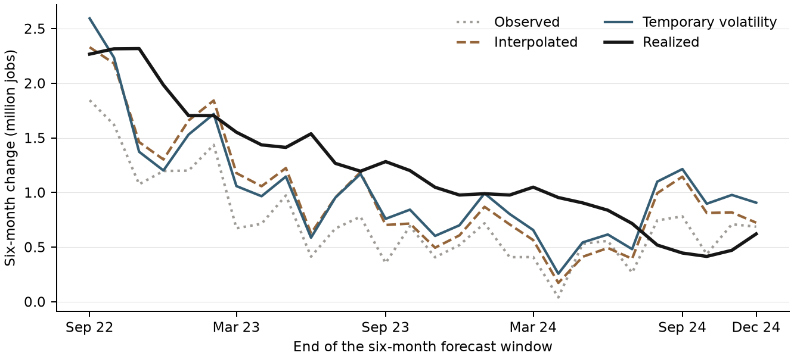

# Payroll Forecasts After a Shock

My doctoral time-series model put the median U.S. payroll gain from March to September 2026 at **about 289,000 jobs**. The gain in the September release vintage was **394,000**. The model kept every pandemic observation and allowed its shocks to be unusually large. The assignment left a practical question open. Would that approach improve a six-month forecast compared with smoothing the pandemic observations?

[One-page executive brief](docs/executive_summary.pdf) · [Research report](docs/payroll_after_shocks.pdf) · [Executed analysis notebook](notebooks/project07_analysis.ipynb) · [Executive summary](EXECUTIVE_SUMMARY.md)

## The assignment and the new comparison

The original predictive median was **0.182** in 100 log points, against realized growth of **0.248**. Its estimated March 2020 innovation variance was **103.55 times** the ordinary level. The independent implementation recovered a median multiplier of **103.67**. It placed median six-month hiring at **315,000 jobs**, an underestimate of 79,000. Interpolation came closest for this period at **354,000**, about 40,000 below the outcome. The underlying class forecast was saved in log units. Its job equivalent uses the forecasting workbook's March payroll level. [Saved estimates](data/coursework.csv) · [Reference forecasts](results/reference.csv) · [BLS release levels and vintages](data/README.md)

## When did each approach help?

All three Bayesian vector autoregressions (BVARs) use five monthly series, twelve lags and the same six-month target. Each forecast starts from observed conditions. Across 28 post-pandemic origins, interpolation had the smallest forecast error on revised employment levels. Temporary volatility cut error by **22.6%** compared with fitting constant variance to all observed data. It also retained the pandemic observations.

| Forecast method | RMSE on revised payroll gains | RMSE on sum of first announcements | Mean width of 90% interval |
| --- | ---: | ---: | ---: |
| Observed history, constant variance | 611,000 | 874,000 | 7.89 million |
| Interpolated training history | **459,000** | 694,000 | 3.08 million |
| Observed history, temporary volatility | 473,000 | 665,000 | 3.20 million |
| Repeat the preceding six-month gain | 596,000 | **515,000** | Point forecast only |

RMSE is the root mean squared error in jobs. The sum of first announcements combines six initial monthly changes, each published at a different date. The standings reverse between the two pandemic treatments when the outcome changes. The simple rule was added as a supplementary check after the three BVARs were scored. All three models' intervals covered every revised outcome, and all 28 outcomes were gains. Monthly origins overlap. Interpolation beat temporary volatility in four of six nonoverlapping offsets. [Matched forecasts](results/forecasts.csv) · [Scores by target and offset](results/scores.csv) · [Simple benchmark](results/persistence.csv)



**The latest observations matter.** Interpolating the training sample and then feeding its smoothed lags into the forecast raised revised-target RMSE from **459,000 to 708,000 jobs**. The same fitted coefficients produced both forecasts at each origin. [Starting-state sensitivity](results/smoothed_state_scores.csv)

**A retrospective stress scenario.** For February to August 2020, the observed decline was **11.47 million jobs**. Holding the February starting state and the post-crisis parameter draws fixed, the lower end of the 90% interval moved from **−0.64 million** under ordinary shocks to **−11.71 million** when allowing elevated variance. The scenario uses the crisis dates and parameters learned later. [Scenario results](results/retrospective_scenario.csv)

**A separate signal-extraction check.** Given 200 noisy observations, the Kalman filter recovered the class result for the terminal signal. Its median was **−2.14685**, with quartiles **−2.71956** and **−1.57414**. Direct conditioning on all messages independently verified the filter. [Signal results](results/signal.json)

## Reproduce the study

The public notebook, verification and report generation use the checked-in results. Re-estimation additionally requires the two matching external input files. The [input notes](data/README.md), [protocol](docs/protocol.md) and [methods](docs/methods.md) describe timing, transformations, conditional distributions, diagnostics, scoring and limitations. The historical design uses revised inputs and the release calendar from Project 06.

Run from the project7 directory using Python 3.12.

```sh
python -m venv .venv
source .venv/bin/activate
python -m pip install -e ../project2 -e ../project6 -e '.[dev]'
pytest -q
python scripts/verify_results.py
python scripts/figures.py
python scripts/build_report.py
```

To re-estimate the models, set WORKBOOK and MESSAGES to the two local paths. Each Gibbs draw is reused through all six forecast steps. Independent seeds repeat the full historical evaluation.

```sh
export OPENBLAS_NUM_THREADS=1 VECLIB_MAXIMUM_THREADS=1 OMP_NUM_THREADS=1
payroll-volatility --workbook "$WORKBOOK" --message "$MESSAGES" --shared-data ../project6/data --project-data data --output results --workers 4
python scripts/replay.py "$WORKBOOK" "$MESSAGES" --workers 4
python scripts/persistence.py "$WORKBOOK"
python scripts/verify_results.py
```

[Model implementation](src/payroll_volatility/model.py) · [Run record](results/run.json) · [Independent replay](results/replay_scores.csv)
