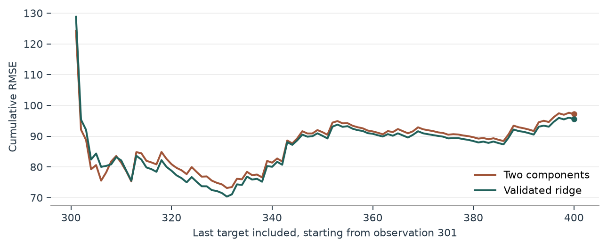

# What can 100 predictors tell us?

In my doctoral time-series assignment, reducing 100 predictors to two principal components produced the lowest forecast error. Could I keep the information in the other predictors without fitting the noise? Selecting the strength of ridge regression on earlier observations lowered error from **97.22 to 95.60** on the same 100 one-step forecasts. The improvement was **1.67%** and appeared in both halves of the evaluation.

[Executive summary (PDF)](docs/executive_summary.pdf) · [Research report (PDF)](docs/common_signals.pdf) · [Executed notebook](notebooks/project08_analysis.ipynb) · [Executive summary in text](EXECUTIVE_SUMMARY.md)

## How the forecast changed

| Forecast method | Submitted RMSE | Reconstructed or new RMSE |
| --- | ---: | ---: |
| Ordinary least squares, 100 predictors | 107.992 | 107.992 |
| Ridge with penalty 15, raw predictors and target lags | 98.450 | 98.450 |
| Two principal components | **97.220** | **97.220** |
| Ridge with penalty 15, standardized predictors and target lags | | 96.459 |
| Ridge with penalty 500, selected on earlier observations | | **95.599** |

Every method in the table also uses four lags of the target. The three coursework scores match to the published precision. Standardization makes a given penalty comparable across slope coefficients. Targets 201–300 chose the specification from 14 candidates. Targets 301–400 supplied the final score. Forecasts and transformations were updated using only data available at each origin. RMSE is in the units of the anonymous target Y. Its economic identity and calendar frequency are unknown.

The reduction in mean absolute error was **78.05 to 76.79**. Paired moving-block bootstrap intervals for the 1.62-unit RMSE gain were **[0.19, 3.12]** with blocks of five and **[0.09, 3.08]** with blocks of ten. All estimates refer to this panel and window. [Validation scores](results/validation_scores.csv) · [Individual forecasts](results/forecasts.csv) · [Scores by half](results/scores.csv)



## What the assignment showed about co-movement and hours

| Exercise | Coursework result | What the project established |
| --- | --- | --- |
| Monthly U.S. activity | A persistent common signal, with average persistence 0.8254. | The original four loadings and persistence reproduce. Matching adjustments to the income series by name changed its loading from 0.2064 to 0.3225 with the same sampler. The full model estimated persistence of 0.8115 under the named adjustments and 0.2427 with all observed changes retained. |
| Daily equity returns | Figures for SPY, QQQ, IWM and DIA described a common market movement. | On 4,126 documented trading days, the average loadings ranged from 0.883 to 0.992 and daily factor persistence was −0.101. The class price vintage and exact dates remain unverified. |
| U.S. hours after a favorable technology shock | Through 1994Q3 the mean impact on log hours was −0.002411, with 98.25% posterior probability of a decline. The longer sample had a negative median through quarter 12. | The refit gave −0.002430 and 98.10% through 1994Q3, then −0.002882 and 99.88% through 2019Q4. The extended quarter-12 median was negative, but its central 80% interval included zero. Interpretation assumes only technology permanently changes productivity. |

The factor estimates describe co-movement in separate monthly and daily datasets. The technology exercise uses quarterly productivity and hours. None of these series supplies an economic label for the indexed forecast target. [Coursework record](data/coursework.csv) · [Column assignment audit](results/column_audit.csv) · [Factor estimates](results/factor_parameters.csv) · [Hours responses](results/hours_responses.csv)

## Reproduce the results

From the project8 directory, using Python 3.12:

```sh
python -m venv .venv
source .venv/bin/activate
python -m pip install -e ../project2 -e ../project6 -e '.[dev]'
pytest -q
python scripts/verify_results.py
python scripts/figures.py
python scripts/build_report.py
```

The checks, notebook and reports work from the published results. Full estimation requires the matching external data snapshots. Set DATA_DIR to the folder with the two workbooks and the two quarterly files, and EQUITY_SNAPSHOT to the frozen adjusted-close CSV. For a new market-data vintage, fetch it and add `--new-equity-vintage` to the estimation command, using a fresh output directory. Provider adjustments can change historical prices.

```sh
mkdir -p .local
export OPENBLAS_NUM_THREADS=1 VECLIB_MAXIMUM_THREADS=1 OMP_NUM_THREADS=1
python -m common_signals.study "$DATA_DIR" "$EQUITY_SNAPSHOT" .local/replay
# Optional fresh retrieval
python scripts/fetch_equities.py .local/adjusted_closes.csv
```

The implementation uses separate classes for the forecast panel, the dynamic factor and the technology VAR. It reuses the portfolio’s existing Bayesian VAR utilities and chain diagnostics. The study can run by stage with `--stage forecast`, `--stage factor` or `--stage structural`. [Input records](data/README.md) · [Evaluation protocol](docs/protocol.md) · [Statistical methods](docs/methods.md) · [Factor diagnostics](results/factor_diagnostics.csv) · [Structural diagnostics](results/hours_diagnostics.csv)
